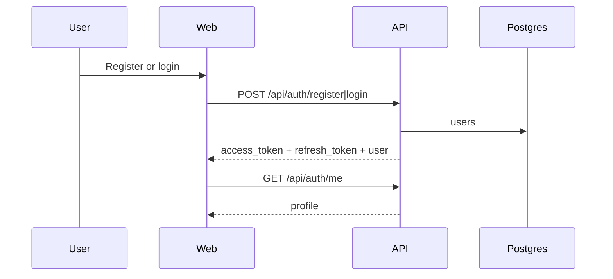
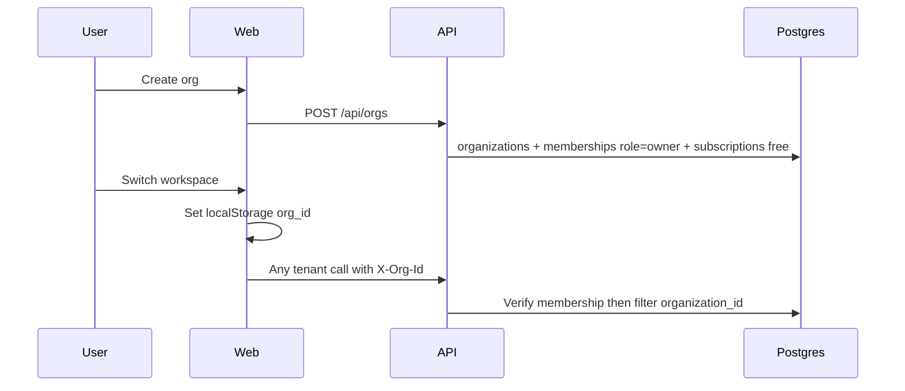
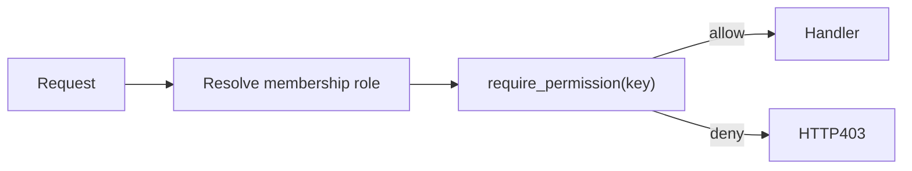
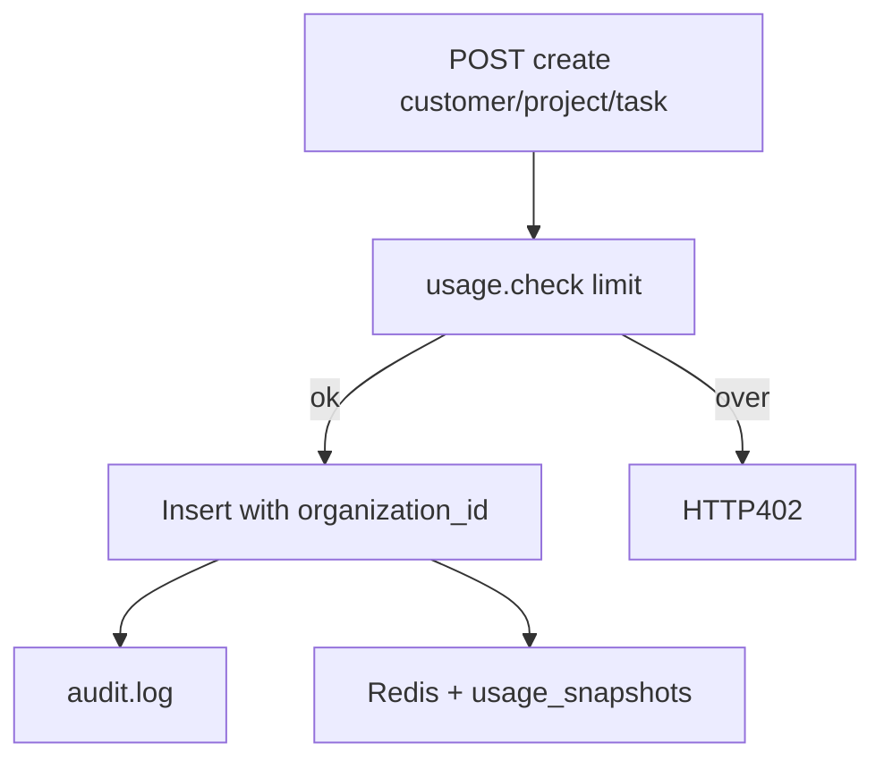
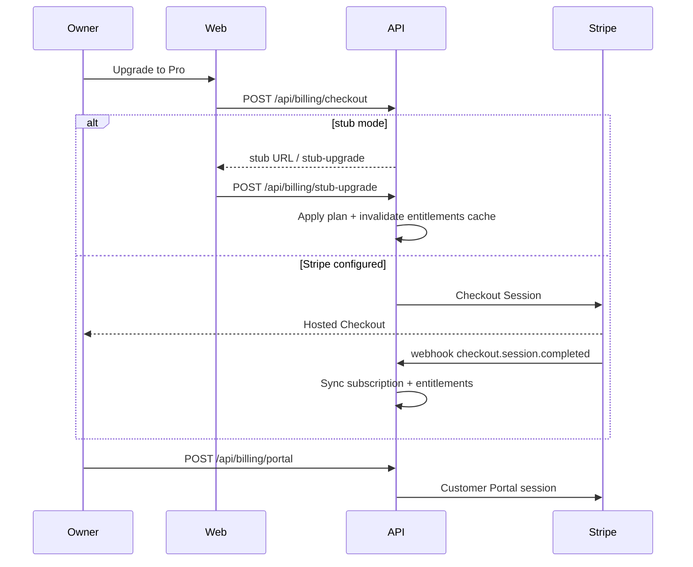
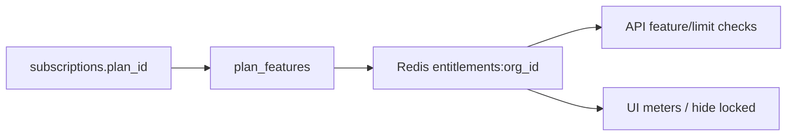

# Flow Suite — System Flows

How authentication, multi-tenancy, RBAC, work management, billing, entitlements, usage limits, and audit logging fit together.

```text
Browser (:3001)
  → HTTP API (:8090) FastAPI modular monolith
  → Postgres (tenant rows) + Redis (entitlements/usage cache)
  → Stripe test mode (Checkout / Portal / webhooks) or stub billing
```

Every tenant request carries `Authorization: Bearer <jwt>` and `X-Org-Id: <organization uuid>`.

---

## 1. Authentication



Tokens are JWTs (`sub` = user id). Refresh via `POST /api/auth/refresh`.

---

## 2. Organization tenancy



| Concept | Implementation |
|---------|----------------|
| Isolation | Shared Postgres schema; row-level `organization_id` |
| Context | `get_org_context` dependency |
| Switch org | Client changes header only |

Invites: owner/admin `POST /api/orgs/invites` → invitee registers with same email → `POST /api/orgs/invites/accept` with token.

---

## 3. RBAC

Roles: `owner`, `admin`, `member`, `viewer`.



Examples: `customer:write`, `project:write`, `member:invite`, `billing:manage`, `audit:read`.

Map lives in [`apps/api/app/modules/rbac/permissions.py`](apps/api/app/modules/rbac/permissions.py).

---

## 4. Customers, projects, tasks



All list/get/update/delete queries constrain `organization_id == X-Org-Id`.

---

## 5. Billing (Stripe test or stub)



Plans: **Free**, **Pro**, **Business** (seeded with feature limits).

---

## 6. Entitlements



Boolean features (`audit_log`, `sso`, …) and numeric limits (`max_projects`, …).
Locked feature → HTTP **402** `{ code: feature_locked }`.

Audit UI calls `require_feature(..., "audit_log")` (Pro+).

---

## 7. Usage limits

Metrics: `seats`, `projects`, `tasks`, `customers`.

Before create: recount → compare to entitlement → **402** `{ code: usage_limit }` if exceeded.
Counters cached in Redis `usage:{org_id}:{metric}` and stored in `usage_snapshots`.

---

## 8. Audit logging

Sensitive mutations call `write_audit(...)` (org create, invites, role changes, CRM deletes, billing events).

```text
GET /api/audit  →  require AUDIT_READ + audit_log entitlement
```

---

## 9. Request map

| Action | Method | Path |
|--------|--------|------|
| Register/login | POST | `/api/auth/register`, `/api/auth/login` |
| List/create orgs | GET/POST | `/api/orgs` |
| Members / invites | GET/POST | `/api/orgs/members`, `/api/orgs/invites` |
| Customers | CRUD | `/api/customers` |
| Projects / tasks | CRUD | `/api/projects`, `/api/projects/{id}/tasks`, `/api/tasks/{id}` |
| Plans / summary | GET | `/api/billing/plans`, `/api/billing/summary` |
| Checkout / portal | POST | `/api/billing/checkout`, `/api/billing/portal` |
| Stub upgrade | POST | `/api/billing/stub-upgrade` |
| Webhook | POST | `/api/billing/webhook` |
| Audit | GET | `/api/audit` |

---

## 10. Demo script

1. Open http://localhost:3001 → sign in as `owner@flowsuite.com` / `owner123`.
2. Home shows Free plan usage meters for **Acme Demo**.
3. Add customers and projects; create tasks.
4. **Billing** → Upgrade to Pro (stub applies instantly).
5. **Audit** → trail visible after Pro entitlement.
6. **Team** → invite `member@flowsuite.com`; accept token under Settings after login as member.
7. Hit Free limits by stub-upgrading back to Free then creating until **402 usage_limit**.
